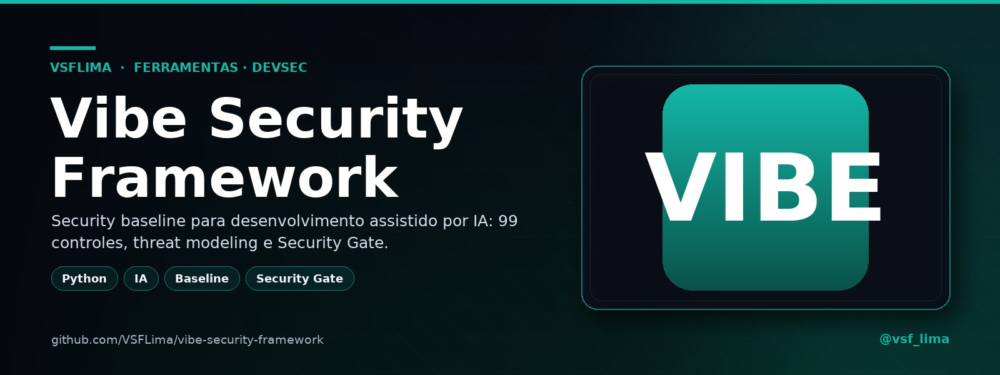
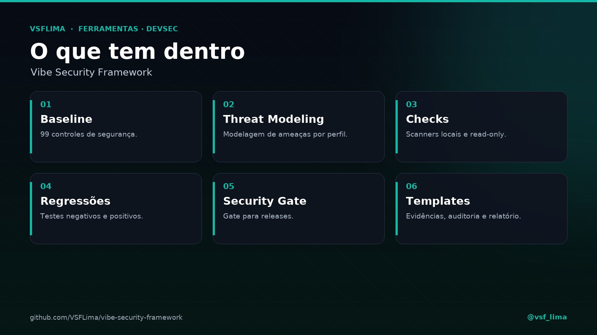

<div align="center">



# 🛡️ Vibe Security Framework

> **Security Baseline para desenvolvimento assistido por IA** — 99 controles, Threat Modeling, evidências, regressões e Security Gate.


[](https://t.me/vsf_lima)

</div>

---

## 🚀 Visão Geral

**Vibe Security Framework** — processo de segurança para desenvolvimento com IA
(vibe coding): *Preserve → diagnostique → teste → corrija → reteste → crie
regressão → valide a release*.

Reúne baseline com **99 controles**, Threat Modeling, perfis de aplicabilidade,
registro de evidências, testes negativos/positivos, regressões de segurança e
um **Security Gate** para releases.

É um **processo + conjunto de checks locais**, não um scanner mágico: cada
controle tem evidência, e um `PASS` não promove o controle sozinho.

## ✨ Componentes

| Item | Descrição |
|---|---|
| 📋 **Baseline** | 99 controles (`baseline`) |
| 🧠 **Threat Modeling** | Modelagem de ameaças |
| 🍥 **Profiles** | Perfis por arquitetura |
| 🧪 **Checks** | Testes negativos e positivos |
| 🔁 **Regressões** | Testes de regressão de segurança |
| 🚪 **Security Gate** | Gate para releases |
| 🎯 **Templates** | Templates de evidência/documentação |

## 🖼️ Prévia

<p align="center">
  
</p>
<p align="center"><em>Baseline, Threat Modeling, checks, regressões e Security Gate.</em></p>

## 📁 Conteúdo

`baseline`, `checks`, `docs`, `profiles`, `prompts`, `templates`,
`SECURITY_START_HERE.md`, `DISCLAIMER.md`, `CHANGELOG.md`.

```text
.
├── baseline/       # 99 controles
├── checks/         # scanners locais + testes dos checks
├── docs/           # referências
├── profiles/       # API, web, SaaS, mobile, OAuth, IA, infra...
├── prompts/        # auditoria, correção, regressão e release
├── templates/      # evidências, threat model e gate
├── SECURITY_START_HERE.md
└── DISCLAIMER.md
```

## ⚙️ Como usar

```bash
# Rodar a camada de checks no repositório atual
python3 checks/run_checks.py --target .

# Saída estruturada em JSON
python3 checks/run_checks.py --target . --json

# Testes de contrato dos checks
python3 checks/tests/test_checks.py
```

Os checks são **locais e read-only por padrão**. A leitura é:

| Resultado | Significado |
|---|---|
| `PASS` | O check não encontrou a condição que procura. |
| `WARN` | Evidência parcial ou limitação da verificação. |
| `FAIL` | Achado — exige correção/regressão. |

O framework tem **35 testes** distribuídos pelos arquivos de `checks/tests/`,
cobrindo checks nativos, adaptadores Gitleaks/Trivy, evidências, SARIF e a
política do release gate. A camada de checks está em **v0.2.2**; o framework
está em **v1.0.0**.

## 📦 Download

| Arquivo | Link |
|---|---|
| `vibe-security-framework-master.zip` | [baixar o branch `master`](https://github.com/VSFLima/vibe-security-framework/archive/refs/heads/master.zip) |

## 📌 Status

- **Versão:** 1.0.0 (framework) / 0.2.2 (camada de checks).
- **Testes:** 35 testes de contrato.
- **Licença:** MIT (`LICENSE`).
- **Repositório público.**

## 🤝 Contribuindo

Contribuições são bem-vindas! Leia o [`CONTRIBUTING.md`](CONTRIBUTING.md). O projeto é open source sob a licença MIT.

## 📄 Licença

Distribuído sob a licença **MIT**. Veja [`LICENSE`](LICENSE).

## 🙏 Créditos

- **Projeto, baseline e documentação:** VSFLima
- **Distribuição:** [@vsf_lima](https://t.me/vsf_lima)
- **Stack:** Python, checks locais, Gitleaks/Trivy (adaptadores), SARIF

---

> 🌐 **Repositório público.**

<p align="center">Feito por <a href="https://t.me/vsf_lima">@vsf_lima</a> — VSFLima</p>
